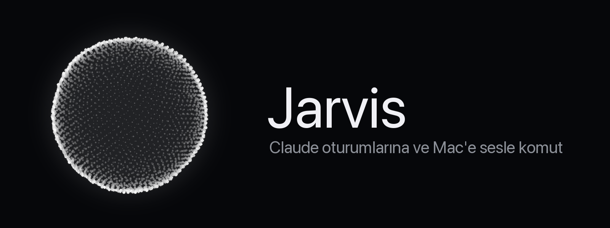

<p align="center"></p>

<p align="center">
  
  
  
  
  
</p>

> **Rodosgrup test projesi.** Üretim ürünü değildir; sesli asistan, konuşmacı tanıma ve Claude Code oturumlarıyla etkileşim denemeleri için geliştirilmektedir.

**Jarvis**, Mac'inizin menü çubuğunda yaşayan sesli asistandır. Adını söylersiniz, uyanır; açık Claude Code oturumlarınıza görev verir, WhatsApp ve Mail'i sizin adınıza kullanır, işi bitince gelip sonucu okur. Yalnızca sizin sesinize tepki verir.

```
Siz:    "Jarvis, web projesine söyle testleri çalıştırsın."
Jarvis: "İlettim."                         … 40 sn sonra …
Jarvis: "Web projesi bitirdi: 42 test geçti, iki uyarı var."
```

---

## Neler yapar

| | |
|---|---|
| 🌙 **Bekleme modu** | Mikrofon açık ama dışarı tek bayt ses gitmez. Uyandırma kelimesi ("Jarvis", değiştirilebilir) cihaz içi tanımayla yakalanır. |
| 🗣️ **Sesli sohbet** | Uyanınca OpenAI Realtime'a bağlanır, "Sizi dinliyorum." der, Türkçe konuşur. Cevaptan sonra 5 saniye sessizlikte uyur. |
| 🧑‍💻 **Claude oturumları** | Açık oturumları listeler, durum sorar, görev verir; oturum bitirince özetini okur. Uyuyorsa uyanıp haber verir. |
| 💬 **Mac görevleri** | WhatsApp, iMessage, Mail, Kişiler, Takvim, uygulama açma, dosya bulma. Gönderme gibi geri alınamaz adımlarda önce "göndereyim mi?" diye sorar. |
| 🔐 **Sadece sizin sesiniz** | Sesinizin parmak izini yerelde çıkarır, her cümleyi yabancı referans seslerle karşılaştırır. Yabancı ses uyandıramaz, uyandırsa da ilk cümlede elenir. |
| ⚪ **Küre** | Siyah zeminde parçacık küresi: beklerken mavi, dinlerken beyaz, konuşurken kırmızı; sesinizle dalgalanır. |

## Hızlı başlangıç

```sh
brew install xcodegen
sh scripts/fetch-vendor.sh      # sherpa-onnx + konuşmacı modeli (vendor/, git'e girmez)
xcodegen generate
xcodebuild -project Jarvis.xcodeproj -scheme Jarvis -configuration Debug -derivedDataPath build build
open build/Build/Products/Debug/Jarvis.app
```

1. Menü çubuğundaki simge → **Ayarlar…** → OpenAI API anahtarı (Keychain'de saklanır).
2. **Sistem Ayarları › Klavye › Dikte**'yi açın. Uyandırma kelimesi Apple'ın konuşma tanımasına bağlıdır; Dikte veya Siri kapalıysa çalışmaz (hata 201).
3. **Dinle** deyin, mikrofon ve konuşma tanıma izinlerini verin. Jarvis beklemeye geçer.
4. Ayarlar › **Sesimi kaydet…** ile sekiz cümle okuyun. Yabancı referans sesler bir kez üretilir, profil çıkar, "sadece benim sesim" açılır.
5. "Jarvis" deyin.

## Nasıl çalışır

```
 mikrofon ──► AudioEngine ──┬──► WakeWord           cihaz içi, "Jarvis"            ← beklemede yalnız bu
                            ├──► SpeakerVerifier    yerel parmak izi + kohort      ← uyanışta ve her cümlede
                            └──► RealtimeClient ──► OpenAI Realtime ──► hoparlör
                                                         │ araç çağrıları
            ┌────────────────────────────────────────────┼──────────────────────────────┐
   list_sessions · get_session_status              send_task                    mac_task · mac_confirm
   SessionStore  (~/.claude kayıtları)        Orchestrator (headless claude,    Mac işçisi (headless claude,
                                              yalnız SendMessage)              yalnız osascript/open/shortcuts/mdfind)
                                              Watcher: oturum boşa düşünce
                                              son mesajını okur
```

- **SessionStore** Claude'un kendi kayıt dosyalarını salt okunur kullanır; ayar değiştirmez, hook kurmaz.
- **Orchestrator** kod çalıştıramayan bir headless Claude; görevi hedef oturuma SendMessage ile iletir.
- **Mac işçisi** yalnız `osascript`, `open`, `shortcuts`, `mdfind` çalıştırabilir. Geri alınamaz işten önce `ONAY:` ile durur; Jarvis sorar, "evet" deyince devam eder. Etiketsiz cevap "yapılmadı" sayılır.
- **Watcher** görev verilen oturumu izler; çalışıp boşa düşünce son mesajını "[BİLDİRİM]" olarak sese sokar.

### Sesinizi nasıl tanıyor

Shazam'ın yaptığı gibi aynı kaydı aramıyor; her seferinde farklı kelimeler söylüyorsunuz. Bunun yerine ses renginizin parmak izini (embedding) çıkarır ve karşılaştırır:

1. **Profil**: kayıttaki sekiz cümlenin ayrı ayrı parmak izleri. Jarvis'in güvenle kabul ettiği her uzun cümle profile eklenir; sizi dinledikçe daha iyi tanır (en fazla 40 örnek).
2. **Kohort**: OpenAI'nin on sesine üçer cümle okutularak üretilen 30 yabancı referans. Dışarıya yalnız metin gider.
3. **Karar**: cümle size mi, en yakın yabancıya mı daha çok benziyor? Belirgin fark varsa *sahibi*, yabancı kadar benziyorsa *yabancı*, arası *belirsiz*. Uyanışta tek kelime ölçüldüğü için yalnız açıkça yabancı sesler elenir; asıl karar ilk cümlede verilir. Güvenilir oturumda kısa sesler ("evet", "hı") sorgulanmaz.

Model: WeSpeaker ResNet34-LM (sherpa-onnx, 16 kHz, 256 boyut). Güvenlik kilidi değil, filtredir.

## Ayarlar

| Ayar | Varsayılan | Not |
|---|---|---|
| Model | `gpt-realtime` | `gpt-realtime-mini` üçte bir fiyat, Türkçesi zayıf |
| Ses | `marin` | OpenAI'nin 10 sesi |
| Uyandırma kelimesi | `Jarvis` | Tanıyıcı İngilizce; yakın yazımlar kabul edilir ("Mikail" → "mikhail") |
| Mikrofon | Dahili | AirPods mikrofonu kulaklığı telefon kalitesine düşürür; ses yine kulaklıktan çalar |
| Sadece benim sesim | açık | Kayıt sonunda kendiliğinden açılır |
| claude argümanları | `--permission-mode auto` | Hedef oturumlarla aynı izin sınıfı olmalı, yoksa mesaj onay bekler |

## Maliyet

| | Dakika başına | Günde 30 dk |
|---|---|---|
| gpt-realtime | ~0,05–0,10 $ | ~2–3 $ |
| gpt-realtime-mini | ~0,02 $ | ~0,5–1 $ |

Beklemede ve sessizlikte ücret işlemez. Uyandırma kelimesi ve konuşmacı tanıma tamamen yereldir. Kohort üretimi tek seferlik, birkaç sent.

<details>
<summary><strong>Ölçülmüş tuzaklar</strong> (geliştiriciler için)</summary>

- **Headless orkestratör mesaj alamıyor**: `/tmp/cc-socks` altında soket açmıyor, ListAgents'ta görünmüyor. Cevaplar dökümden (Watcher) okunur.
- **macOS 27'de SwiftUI fare takibi çöküyor**: MenuBarExtra'nın `.window` stili ve çerçevesiz paneldeki NSHostingView, fare üstünden geçince `PointerBridge.mouseMoved` içinde SIGSEGV. Menü düz NSMenu, küre saf AppKit (NSView + Core Graphics), fare olaylarını yok sayar.
- **Küre çizimi ana iş parçacığını kilitliyordu**: 60 Hz çizim 16 ms'yi aşınca runloop hiç uyumuyor, ana kuyruk sıra alamıyor. Çizim arka planda, ekrana hazır resim konur.
- **Yankı önleme + oynatıcı aynı motorda açılmıyor** (-10875). İki ayrı AVAudioEngine. Yankı önleme ayrı motordan çalan sesi silmez; bu yüzden Jarvis konuşurken ve bitiminden 400 ms sonrasına kadar mikrofon modele gönderilmez.
- **AirPods mikrofonu**: kulaklığı 24 kHz telefon profiline düşürür, her profil geçişinde motor yeniden kurulur (23 kez üst üste ölçüldü). Dinle açıkken sistem mikrofonu dahiliye çevrilir, kapanınca geri yüklenir. Motorun giriş birimine aygıt atamak (kAudioOutputUnitProperty_CurrentDevice) -10875 veriyor; sistem varsayılanını değiştirmek sorunsuz.
- **Yankı önlemeli mikrofon dizisi 3–5 kanal verir**, hepsi aynı işlenmiş sinyal; ilk kanal alınır. Ses kısıktır, sessizlik filtresinin mutlak tabanı düşük tutulur.
- **Aynı motora ikinci tap** istisna fırlatıp uygulamayı kapatıyor; her denemede taze motor.
- **Tek kelimelik "Jarvis" konuşmacı için yetersiz**: cümleler 0,8+ alırken tek kelime 0,4–0,7 arasında savruluyor. Uyanışta yalnız açıkça yabancılar elenir.
- **Model sesi gerçek zamandan hızlı gönderir**: "cevap bitti" olayı ses çalarken gelir. Konuşuyor durumu gerçek çalma sayacına bağlı.
- **Araç çalışırken uyunmaz**: Mac görevi 30 sn sürebilir; uyku sayacı araç bitene kadar ertelenir.
- `AVCaptureDevice.requestAccess` geri çağrısından `Task { @MainActor }` çalışmadı; `DispatchQueue.main.async` kullanılıyor.
- Oturum status alanı `idle` / `busy`; ölü pid kayıtları `kill(pid, 0)` ile ayıklanır.
- Debug'da `-jarvisOrb YES` küreyi açılışta gösterir. Her satır `~/Library/Logs/Jarvis.log` dosyasına yazılır; son ölçülen ses kesitleri `jarvis-uyanis.wav` / `jarvis-cumle.wav` olarak yanına düşer.

</details>

## Yol haritası

- [ ] Ucuz ses hattı: tamamen yerel (Apple konuşma tanıma + Türkçe sistem sesi), sıfır maliyet
- [ ] Vardiya'nın 3D ofisine entegrasyon: "şu masadaki Claude'a söyle"
- [ ] Global kısayol ile uyandırma

## Geliştirme

- İkon, logo ve kapak: `python3 scripts/make_icon.py` (Pillow). Logo, uygulamadaki kürenin aynısıdır.
- Proje dosyası xcodegen ile üretilir; `Jarvis.xcodeproj` git'e girmez.
- Kod yorumları Türkçe, tanımlayıcılar İngilizce.

## Lisans

© 2026 Rodosgrup Yazılım Ekibi
